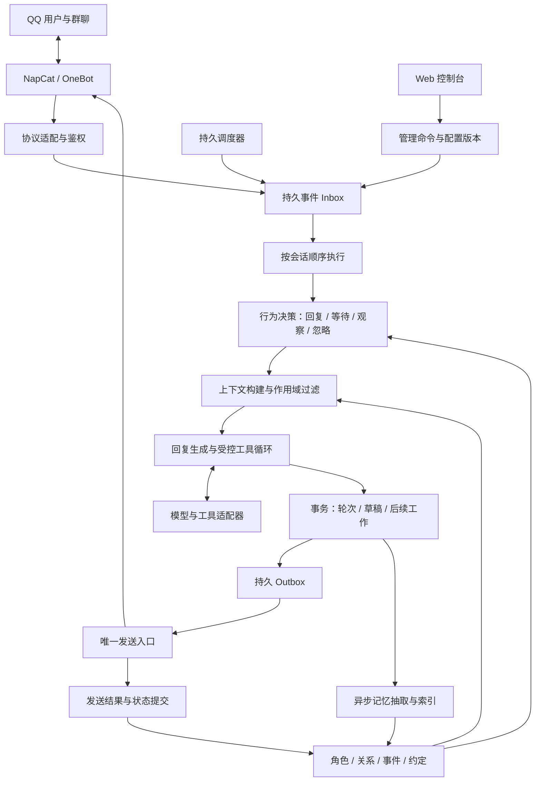
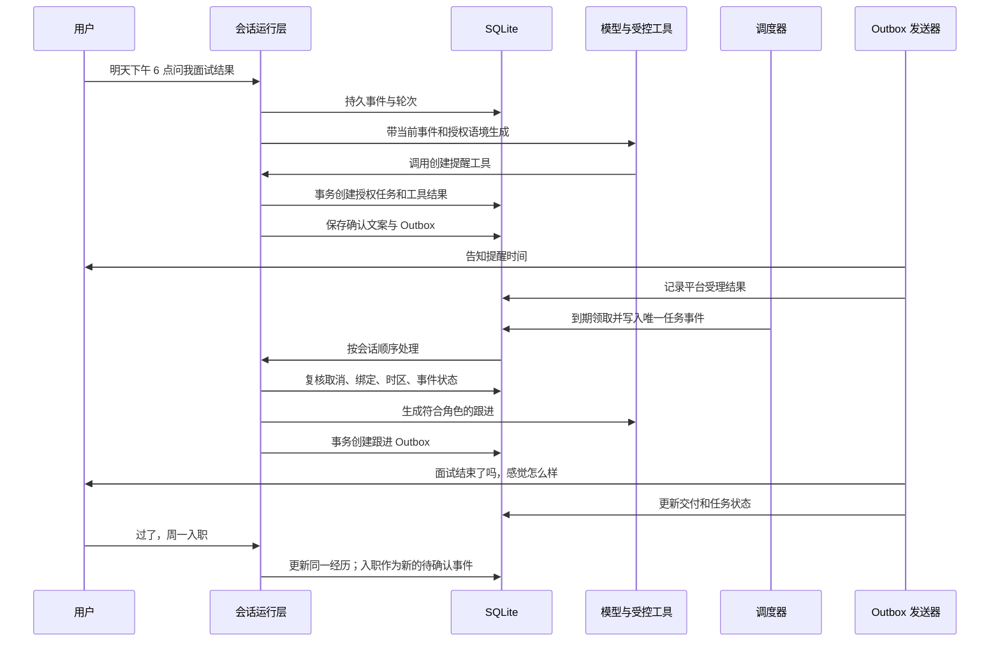

# openqqwaifu 架构重置方案

状态：原方案已进入分阶段实施。日期：2026-10-26。

进展：新版私聊运行链路、结构化上下文、会话控制台、事实/经历修订、持久提醒、删除恢复屏障已逐步接入；主动联系规则、跟进候选、角色化草稿与经历时间提取已接入；最新批次为 [经历时间对话确认](RUNTIME_V2_EPISODE_TIME_DIALOGUE.md)，用户可直接在私聊中澄清、选择和明确确认时间，支持取消、更正、重启恢复及来源审计，时间变更仍使旧草稿与未发送排期重新等待核对。[首轮连续对话试验](RUNTIME_V2_EXPERIENCE_TRIAL.md) 已修复追问节奏、委婉边界识别和情绪上下文丢失，并为结构化输出接入 JSON 模式。DeepSeek 官方 Flash-1017 的纯对话对照已体现两角色差异，但结构化模式仍出现空白返回，完整链路未通过真实体验验收。下文保留原设计与验收目标，未实现部分不能视为已有能力。

本方案基于当前工作区的代码，以及本轮清查后尚未提交的修复。它定义下一阶段的目标架构、迁移边界和验收方式，各项功能的实际完成范围以阶段实现文档为准。历史迁移文档仅作背景；本轮没有重新审计其他机器人项目，也没有进行真实 QQ 或付费模型验证。

建议先读第 1—4 节确认方向，再读第 13 节的完整样例、第 15 节的投入和第 18 节的产品选择；其余章节用于核对实现与迁移细节。

## 1. 建议先达成的共识

**把 openqqwaifu 建成一个有稳定角色、共同经历和时间连续性的 QQ 陪伴程序。** 工具调用服务于交流，角色能够记住发生过什么、知道哪些事情尚未结束，并在合适的时机回应。

建议采用以下方向：

1. 保留 Python 服务、NapCat sidecar、现有控制台和模型/工具适配器，采用模块化单体。
2. 用显式的会话绑定和持久事件队列组织运行，替换依赖“全局当前角色”的业务路径。
3. 围绕角色、关系、事件、约定建立状态；回复、等待、沉默和主动跟进共用一条行为决策链路。
4. 将角色规则、真实对话、检索证据和工具结果分层传给模型，保留消息角色和来源。
5. 先做私聊的完整闭环，再加入群聊节奏和可控的主动行为。
6. 以多日对话、纠错、隐私隔离和故障恢复验收；代码拆分数量、插件数量和好感度增长不作为成功标准。

第一版保持一个部署实例、一个 QQ 账号、一个实际发送者。同一账号可以给不同会话绑定不同角色；同一会话同时只由一个角色回应。账号维度预留在数据结构中，多账号运营与多角色同群对话不进入首版。

## 2. 先定义用户应该感受到什么

### 2.1 必须出现的变化

- **认得人，也认得场合。** 昵称变化不丢失身份；群内称呼与私聊称呼可不同；私聊透露的事情不会自动成为群聊谈资。
- **角色有自己的表达习惯和边界。** 换角色后不仅是名字变化，关注点、说话节奏、兴趣和处理冲突的方式也不同。
- **能接着昨天的事情聊。** “明天面试”是一个有时间、有来源、等待结果的事件；之后的“过了！”能够更新同一件事。
- **纠正能够生效。** “不是周三，是周四”更新目标事件；“别再这样称呼我”成为稳定偏好，不被旧记忆重新覆盖。
- **关系变化有经历支撑。** 能追溯到共同经历、明确表达和修复过程，不因为刷消息、发图片或调用搜索而持续增加亲密度。
- **有合理的沉默。** 连续发出的几条话能合起来理解；别人之间的群聊不会被无条件抢答。
- **承诺有实际状态。** 提醒是否创建、是否取消、是否尝试发送、结果是否明确，都可以查看。

### 2.2 不在本轮架构重置的首版范围内

微服务、独立向量数据库、图数据库、训练专用模型、多人格辩论式推理、开放插件市场扩张、语音通话、虚拟形象直播和复杂剧情引擎均后置。现有图片和工具能力可继续使用。

架构也不能单独保证角色魅力。角色内容、示例对话、模型能力与延迟需要共同打磨；仅换目录、加一层“思考模块”或加长人设提示词，达不到上述目标。

## 3. 当前结构为何难以达到这个体验

以下是对当前实现的观察，与已经修复的可靠性缺陷分开看待：

1. **上下文接口偏向一次性问答。** `prompt_assembler.py` 的 `_reply_messages` 将工具规则放入 system，再把已拼装的人设、记忆、历史和最新消息放入一个 user 内容。角色卡虽有 `system_prompt` 方法，这条调用路径没有把它作为独立 system 层传入。Dify 路径同样围绕大段字符串调用。
2. **持续状态不足。** `SessionMemory.history` 是字符串列表；事件缺少完整的时间、引用、来源与处理版本信息。后续想纠正某件事或重放某一轮，只能从拼装文本反推。
3. **情绪和关系过于机械。** 情绪主要依赖关键词；关系分数会因一次回复、私聊、图片、搜索等累加。这些实现适合演示，不足以支撑长期关系。
4. **主动行为未形成执行闭环。** 当前 `ProactivePlanner` 主要筛选候选人并生成固定文案；缺少持久任务、发送前复核、取消和结果反馈。
5. **发言判断粒度较粗。** 私聊基本总是回复，群聊主要依赖提及和追问窗口；难以处理多人接话、消息连发和对话对象变化。
6. **业务依赖可变的运行状态。** 多个服务引用同一个 `WaifuService`，角色切换会影响存储绑定。当前繁忙时拒绝切换的修复是必要保护，目标架构应通过显式上下文消除这类依赖。

已有的身份目录、结构化知识抽取、技能注册、提供商适配和控制台都值得保留。重置重点是运行模型与状态边界。

## 4. 总体架构：模块化单体



所有模块先运行在一个 Python 进程内。会话执行、发送和后台工作可以是独立异步任务，不需要单独部署服务。网络请求不持有数据库写事务。

### 4.1 模块职责

- **接入层**：验证 OneBot 来源，规范化消息、提及、引用和媒体，识别账号，持久接收事件；不决定说什么。
- **运行层**：分配会话顺序、创建轮次、处理打断和控制事件、管理超时与恢复；不拼角色提示词。
- **行为层**：结合硬规则与有限的语义判断，决定是否参与、回应谁、何时回应、可使用哪些能力。
- **角色与关系层**：管理版本化角色、会话绑定、关系证据和暂态情绪；不直接发送消息。
- **记忆层**：维护目录、事实、经历、约定、摘要与索引，负责纠正、删除和作用域过滤。
- **对话层**：构建上下文、调用模型、协调受限工具循环，产出回复提案；不直接改身份或好感度。
- **任务层**：维护持久定时任务，到期只提交内部事件，不能绕过行为层发送。
- **交付层**：执行 Outbox、记录平台回执、更新与发送相关的状态。
- **管理层**：提供配置、角色编辑、记忆纠正、任务管理和诊断接口；所有业务写入经过应用服务。
- **基础设施层**：SQLite、文件资源、模型客户端、OneBot 客户端和指标；通过窄接口供上层使用。

### 4.2 依赖规则与目标目录

领域类型不导入 HTTP、NapCat、具体模型 SDK 或全局服务。应用服务依赖接口；适配器实现接口；仅 composition root 负责装配。禁止后台任务通过“当前角色”查找仓储。

建议逐步形成以下结构，迁移期间允许旧目录共存：

```text
src/waifu_standalone/
  domain/           # 事件、角色、关系、记忆、轮次和任务类型
  application/      # TurnCoordinator、管理用例、状态转换
  runtime/          # Inbox、会话执行、生命周期、配置快照
  behavior/         # 参与判断、群聊节奏、主动行为策略
  conversation/     # ContextBuilder、ResponseComposer、输出约束
  character/        # 角色卡、版本、绑定
  relationships/    # 关系证据、摘要、暂态情绪
  memory/           # 目录、事实、经历、约定、检索与纠正
  scheduling/       # 定时任务与到期事件
  delivery/         # Outbox、发送、结果核对
  capabilities/     # 工具契约、策略、执行记录
  providers/        # LLM、embedding、图片和外部能力适配
  repositories/     # SQLite 仓储与追加式迁移
  gateways/         # OneBot HTTP / reverse WS / NapCat 登录
  web/              # 管理 API、静态控制台
  legacy/           # 迁移期间的兼容入口，最后收缩
```

先建立边界和契约，再迁移实现。不为了目录整齐一次性搬动全部文件。`app.py` 和现有构建函数暂作兼容门面，最终不承担业务决策。

### 4.3 关键内部契约

- `TurnContext`：账号、会话、角色 ID/版本、绑定代次、输入事件 ID、配置版本、数据删除代次、追踪 ID。创建后不可变。
- `BehaviorDecision`：`respond | wait | observe | ignore`、目标对象、原因码、可选唤醒时间、有效期、工具预算。工具执行是受控动作，不是跳过策略的另一条入口。
- `ContextBundle`：分层消息、可见来源 ID、各层 token 用量、被舍弃的内容类别、提供商能力要求。
- `ResponseProposal`：正文/媒体/引用、可选的状态变更提案、实际工具结果引用。不能把模型输出直接当成数据库更新。
- `DeliveryResult`：平台受理、确定失败、结果不明，以及可获得的平台消息 ID。它不代表用户已读。
- `MemoryChangeProposal`：变更类型、作用域、证据、置信度、被修订记录 ID；经验证器后提交。

## 5. 事件、会话与角色绑定

### 5.1 统一事件信封

消息、到期任务、角色切换、记忆纠正和运行控制都进入事件系统，但保留不同类型及权限要求。

建议 `EventEnvelope` 至少包含：

```text
event_id, schema_version, event_type
platform, bot_account_id, source_event_id, dedup_key
conversation_id, conversation_kind, actor_id
occurred_at, received_at, conversation_seq
reply_to_message_id, mentioned_actor_ids, normalized_segments
source_kind, correlation_id, causation_id
payload_ref, content_hash, ingress_policy_version
```

`occurred_at` 是上游时间，`received_at` 是本地接收时间。会话处理顺序由事务分配的 `conversation_seq` 决定，不能靠 QQ 时间戳排序。QQ 用户 ID 是身份依据，昵称只是展示信息。

去重键优先使用账号、事件类型、会话和平台消息 ID 的组合，具体平台适配器定义并测试其唯一性。没有稳定 ID 的事件使用明确的短窗指纹策略，并标记为弱去重；不得承诺完全去重。

HTTP 回调在事件成功持久化后才确认接收；容量不足则返回可重试失败。reverse WS 收到事件后尽快持久化，但 OneBot 连接本身不提供应用级可靠重放保证，断线期间的缺失必须作为可观测限制。不能把本地持久队列宣传成端到端不丢消息。

### 5.2 会话执行与合并消息

执行键固定为 `(bot_account_id, conversation_kind, conversation_id)`。同一会话只有一个执行者；不同会话可并发。账号级限制总模型并发、发送频率和后台工作量。

首版建议同一用户连续发言默认等待 800 ms 合并，最多等待 2 秒；显式命令、取消、管理控制事件不进入普通合并窗。数字是可调初值，需用真实节奏验证。

群聊只合并同一发言人的连续消息，保留每条消息的引用、时间和原始 ID。不同人的消息形成有序上下文，不合成一个人的一句话。合并不跨越角色切换或数据清理控制事件。

模型生成时新消息继续入库。若尚未执行外部副作用、尚未开始发送，且新内容是同一人的补充或纠正，可将旧提案作废并重建一次；设置最大等待时间，避免一直取消一直不回复。已经执行的工具不能因重建而盲目再执行。

显式取消、撤销授权和紧急停发不能等待一个慢模型调用结束。经过鉴权且目标明确的控制命令先事务写入取消标记/版本并发送协作取消信号，再以控制事件进入会话记录；执行者和发送器检查该标记。这个受限控制通道只能收紧或取消已有动作，不能直接生成回复或发起新副作用。自然语言取消需要先解析目标，不能声称在尚未识别时已经生效。

### 5.3 明确角色绑定，不再交换全局存储

`ConversationBinding` 记录会话当前角色、角色版本和 `binding_generation`。每轮保存明确的 `TurnContext`，所有仓储调用都显式携带账号、角色和作用域。

切换角色的默认流程：

1. 管理操作写入有顺序号的 `character_binding_changed` 控制事件，返回操作 ID。
2. 该事件之前的普通事件按旧绑定处理；该事件之后的事件按新绑定处理。接收时只分配顺序，具体角色绑定在创建轮次时按控制事件边界确定并冻结。
3. 等待旧轮次与已开始的发送结束；未发送提案可按显式“立即切换”操作取消。存在结果不明的发送时，暂停该会话的后续发送与切换，进入核对流程。
4. 在同一数据库事务中更新绑定代次。新轮次使用新角色，旧后台记忆任务仍带旧角色和来源，不会写入新角色。
5. 旧绑定的主动任务默认暂停，显示待处理列表。切回角色不会自动补发过期任务；经重新启用和时效检查后恢复。

角色 ID 稳定，角色内容通过版本迭代。改措辞可保留角色关系；“复制成新角色”生成新 ID 和独立关系。角色版本与绑定代次是不同概念。切换角色不会删除历史，也不会默认把旧角色的私人记忆注入新角色。

控制台中的“默认角色”只决定新会话的初始绑定。批量切换现有会话是独立操作，展示影响范围，不再暗中改变所有会话。

## 6. 数据模型和事务边界

### 6.1 明确选择：一个新的统一 SQLite 运行库

首版使用 `data/runtime-v2.sqlite3` 作为部署内业务状态的唯一权威运行库，启用外键、WAL 与受控短写事务。账号 ID 纳入所有业务主键/唯一约束和作用域校验。先支持单账号运行，避免过早扩展部署。

角色 YAML 保留为导入/导出格式，发布后的角色版本保存在库内。附件保存在独立文件目录，通过内容摘要和状态记录引用。向量索引和 JSONL 导出都是可重建派生数据，不与 SQLite 共同充当事实来源。

这意味着会话日志也逐步迁入结构化消息表。旧 JSONL/角色分库作为迁移输入保留只读副本；不能设计“先写 JSONL，再写另一个 SQLite”并称其原子事务。

### 6.2 核心实体

**身份与角色：**

- `users`、`group_memberships`：账号内稳定用户身份、群成员关系、群名片、已确认称呼及来源。模型没有直接更新权限。
- `characters`、`character_versions`：稳定 ID、版本、人设内容、行为偏好、发布状态；旧版本可追溯。
- `conversations`、`conversation_bindings`：群/私聊标识、时区与策略、绑定变更历史。
- `permission_grants`：用户主动授权、群管理员策略、能力范围、生效与撤销时间。管理员开启功能不能替代私聊对象的主动联系许可。

**交互与交付：**

- `inbox_events`：规范事件、去重键、顺序号、处理状态、尝试次数。
- `turns`、`turn_inputs`：一轮所用事件、固定上下文版本、决策、处理阶段和终止原因。
- `messages`：作者身份、角色类型、结构化分段、来源与引用、平台消息 ID、交付状态。待发草稿不会冒充已发生的 assistant 消息。
- `outbox_messages`、`delivery_attempts`：唯一逻辑输出、分段序号、执行租约、每次发送的实际结果。
- `tool_invocations`：调用方、工具版本、参数摘要、授权结果、执行状态、幂等键和真实结果引用。

**持续状态：**

- `facts`、`fact_revisions`：结构化事实/偏好、有效期、证据、纠正与取代关系。
- `episodes`、`episode_links`：发生过或计划中的事件、参与人、时间范围、结果、相关消息与事实。
- `relationship_evidence`、`relationship_views`：作用域内的关系证据及可重建摘要。
- `mood_snapshots`：角色在会话中的短期状态、原因事件、更新时间、衰减参数。
- `commitments`：谁向谁提出或接受了什么约定、期限、授权来源、履行状态。
- `scheduled_tasks`、`task_occurrences`：触发条件、时区、下一次时间、有效期、每次执行记录。
- `background_jobs`：记忆提取、摘要、索引等持久工作；任务键防重复。
- `deletion_tombstones`、`audit_events`、`migration_runs`：删除屏障、必要审计和导入来源。

约定与提醒是不同对象：“下次继续聊这件事”可以是没有定时器的约定；一份约定也可以关联后续多次任务执行。是否成功创建提醒、平台是否受理提醒、约定是否真正完成分别记录，不能用一个布尔字段代替。

首版可把简单扩展字段放入受 schema 验证的 JSON 列；身份、作用域、状态、时间、版本和唯一键使用独立列。无需把每个字段都拆成新服务。

### 6.3 所有记忆共有的约束

事实、经历、关系证据和约定必须带 `bot_account_id`、`character_id`、`scope`、`source_ids`、`created_at`、`version` 和删除状态。推断项另外带 `confidence`、`extractor_version` 和 `epistemic_status`，区分用户陈述、人工确认、模型推断、角色虚构设定。

置信度只用于排序和复核，不能提升数据的访问权限。模型输出 JSON 通过语法校验也不代表内容是真实的。

关键唯一约束至少包括：入站去重键、会话顺序号、`(turn_id, output_index)`、`(task_id, occurrence_key)`、`(source_batch_id, extractor_version, proposal_key)`。跨账号引用需由复合外键或仓储校验阻断。

### 6.4 提交时机

- **收到消息**：事务写 Inbox 和顺序号；原始用户消息的入库/投影幂等执行。即使机器人最终不回复，用户确实说过的话仍可按记忆策略保存。
- **形成回复**：事务写轮次决策、回复提案、Outbox 和必要工作记录，不把它计入“已经回复”的统计。
- **平台确认受理**：事务更新 Outbox、assistant 历史、互动统计，并激活依赖该条已发回复的约定；后台结果重复提交必须无害。
- **用户明确要求创建提醒**：本地任务工具成功提交任务后，任务即可生效；回复是创建结果的通知。通知失败不能撤销已被用户授权且已创建的任务。
- **机器人自行提出的承诺**：先验证具备权限、时间和可执行能力，再与待发回复关联为 `pending_delivery`；平台受理后才激活。仅在文案里出现“明天提醒你”不构成成功创建任务。
- **记忆抽取**：用户事实可以独立于机器人发送成功提取；涉及机器人说过什么、答应过什么的抽取只能使用已确认受理的回复。失败草稿不得成为共同经历。
- **向量计算、附件写入**：在事务外执行，提交时检查源版本；缺失或过期可重建，不让索引失败回滚已经确认的消息。

## 7. 角色、关系与记忆的具体设计

### 7.1 角色卡升级为版本化角色定义

角色定义建议包含：核心身份、背景设定、价值偏好、兴趣与不擅长的事、口语习惯、关系边界、冲突处理方式、群聊参与偏好，以及少量代表性对话。

稳定的角色设定由管理员发布；模型可提出修订建议，不能自行改名、改核心经历或覆盖规则。短期心情和当日话题独立存储，不能写回角色卡当永久性格。

允许角色拥有明确标注的虚构背景，但“设定里喜欢烘焙”不等于“今天真的去烤了蛋糕”。对于现实观察、联网查询和工具操作，必须有实际来源；剧情模式中的虚构事件使用独立标识，不混入真实用户事实。

首版用两张经过人工设计、差异明显的角色卡验证架构。默认模板也应有具体兴趣和表达样例，不能只写“温柔、体贴、简短”。

### 7.2 关系：证据在前，分数在后

关系主键包含账号、角色、用户和互动作用域。默认不把私聊关系摘要直接用于群聊，也不把群 A 的互动自动传到群 B。

保存的核心是共同经历、称呼偏好、表达过的边界、未解决的问题和修复记录。可附带有界的熟悉度、信任度、互动舒适度，但这些是摘要指标，不是情感事实。

只有带来源的事件可产生有限变化；设每日变化上限和证据类型权重。重复刷屏、机器人自己的长回复和工具调用次数不增加关系。用户说“不要叫我宝贝”立即覆盖对应称呼策略，不需要先扣分再等待阈值。

保留旧好感度为 `legacy_affinity` 兼容展示，默认不驱动新版亲密表达。控制台展示“为什么形成这个判断”和纠正入口，不展示仿佛精确测量出来的爱情百分比。

### 7.3 情绪：理解语境，不给人贴永久标签

区分用户当下情绪线索与角色的短期表达状态。模型可基于本轮语境给出有限标签与证据；低置信度就保持未知。反讽、否定和引用不能简单按关键词归类。

暂态情绪具有有效期与衰减，只影响语气强度和回应方式。它不能越过称呼边界、权限规则或把一次生气写成长期人格。关键词规则可保留为廉价线索，退出权威状态更新路径。

### 7.4 记忆从三层扩展为可管理的几类记录

继续保留“会话历史、稳定身份目录、知识库”的基本隔离，在知识与持续状态中增加明确语义：

- **事实/偏好**：喜欢什么、明确的称呼、已经确认的安排；身份字段仍由目录管理。
- **经历**：某次面试、一次争执、一起完成的任务；记录开始、进展与结果。
- **约定**：答应提醒、下次再聊、用户要求暂停联系；区分建议、接受、取消和完成。
- **工作记忆**：当前话题、最近未回答的问题、群聊正在回应谁；短期有效。
- **摘要**：来源消息的压缩视图，可重建，不作为独立的新证据反复抽取。

纠正采用修订与取代关系，检索优先当前有效版本；旧值保留必要的来源追踪，但退出生成上下文。矛盾不能仅靠相似度覆盖，需要识别主体、属性、时间和修订目标。

检索顺序是权限过滤、有效期与修订过滤，再进行关键词/向量召回和重排。中文词法质量需要独立测试；初期可用可替换的中文分词/字符片段索引加现有 embedding，不能假设默认英文分词配置足够。

图结构先作为经历与来源的显式链接、控制台展示和有限查询能力，不引入独立图数据库，也不把可视化连线当成“已经具有推理能力”。

### 7.5 群聊与私聊的隐私边界

默认允许的可见集合只有：当前会话内容、当前角色在该作用域下的记忆、必要的公开身份信息和管理员发布的角色设定。

同一个 QQ ID 出现在多个群，只说明身份相同，不代表内容可互通。私聊记忆不进入群聊；群聊中的个人内容也不自动迁入私聊。跨场景共享采用明确的授权记录，限定字段、用途和目标作用域。

群里其他人说“他住在某地”只能形成低信任的第三方陈述，不能更新该人的权威资料。转发、引用文本和图片中的指令同样属于内容，不是系统授权。

### 7.6 删除、保留与索引一致性

删除先设置数据删除代次并取消相关待发消息、任务和后台工作，再清除原文、派生事实、关系摘要、向量和缓存。旧后台任务提交时检查删除代次，避免删除后重新写回。已进入外部发送的操作无法保证撤回，界面要显示其状态。

建议初始保留策略：原始协议载荷 7 天、普通消息历史 90 天、脱敏运行追踪 14 天、入站去重标识 30 天；用户保留的经历和有效约定长期保存，直到过期或删除。这些是评审默认值，清理前必须能预览影响；迁移阶段不自动删除旧数据。

原始消息删除后，仅在用户选择保留派生记忆时保留对应事实，并标记来源原文已过期。备份设有限保留期；恢复备份后先应用备份之后的删除清单，再开放检索和发送，避免已删除数据复活。

## 8. 行为决策与模型上下文

### 8.1 硬规则与模型各负责什么

权限、静默时段、消息发送预算、角色绑定、任务是否取消、数据可见范围由代码决定。模型负责语境判断、表达与结构化提案，不能通过文本“决定自己获得权限”。

决策流程：

1. 验证会话与功能是否启用，处理控制命令、取消和强制静默。
2. 判断直接提及、引用回复、当前发言对象与短期话题归属。
3. 对普通私聊和明确提及使用规则路径；对含糊的群聊参与或主动跟进，才进行额外语义决策。
4. 输出 `BehaviorDecision`，由验证器检查动作、时间和预算。
5. `wait` 必须有持久的唤醒条件/时间和有效期；`observe` 表示按配置保留上下文而不发言；`ignore` 表示业务忽略并记录原因。

决策只保存原因码和可供用户理解的简短依据，例如“回应对机器人的引用”“用户已取消提醒”。不保存或展示模型内部逐步推理。

### 8.2 Prompt 分层与角色保真

使用统一 `ModelRequest` 表达消息序列，再由提供商适配器转换：

1. **高优先级规则**：运行边界、稳定角色定义、明确的工具使用约束。
2. **可信运行信息**：当前时间、会话类型、目标对象、已验证授权与行为决策；只含代码生成的数据。
3. **检索证据**：带来源、有效期、作用域和不确定性的记忆/摘要，使用清晰的数据边界，不能提升成可执行指令。
4. **真实会话消息**：按角色保留 user/assistant/tool；群内 user 消息额外注明稳定发言人 ID 与展示名，防止多人混淆。
5. **当前输入与媒体**：作为实际用户消息，保留图片等原生内容块、提及和引用信息。
6. **工具返回**：保留调用 ID、结果状态和来源，不伪装成用户发言或系统规则。

提供商不支持某种消息层级时，由适配器执行明确、测试过的降级；不能静默把全部内容塞成一个 user 字符串并宣称能力等价。现有 Dify 工作流可继续作为兼容后端，但角色分层、工具和多模态能力必须单独检测；首版验收使用能满足新契约的后端。

避免为了“像人”伪造真实世界活动。角色可以自然表达关心，但不知道的事情可以问、不记得的可以承认、没有执行的不能说已完成。

### 8.3 Token、调用次数与延迟预算

普通无需工具的聊天目标是一轮主模型调用。额外分析按需要开启；后台记忆抽取合并批次运行，且显式提醒创建、取消和身份纠正不能等待后台抽取。

以可用输入预算为基础，初始参考分配为：角色与规则约 15%、近期对话约 40%、检索与事件约 25%、本轮与工具结果预留约 20%；当前输入和输出空间优先保障。小窗口模型须缩减示例和召回量，不能机械套比例。

截断优先丢弃低相关召回和旧示例；保留最新输入、明确边界、当前约定，以及完整的工具调用/结果配对。摘要记录来源范围与覆盖版本，避免把旧摘要和全量旧消息重复塞入。

首版工具循环建议最多 3 轮、每轮有限并发，使用整轮截止时间和取消令牌；具体值可配置。达到预算时基于真实已有结果作答，不假造剩余操作完成。

模型超时/不可用时，明确命令仍由本地规则反馈；普通私聊可给一次简短失败提示，群聊避免反复报错刷屏。所有失败都必须可诊断，不能把模板错误回复写入关系正向证据。

## 9. 主动行为与持久任务

### 9.1 两类主动行为必须区分

**明确请求的提醒**：用户说“明天 9 点提醒我面试”，构成该提醒的授权。缺少关键时间/时区时确认一次；任务创建成功后再回复具体时间与取消方式。

**陪伴式跟进**：用户提到面试，并不自动授权隔天主动联系。默认仅形成可供下次聊天使用的待跟进事件；用户开启相应私聊跟进，或明确说“明天来问问我”，才进入发送调度。

群内主动插话与群内提醒分别受群策略控制；管理员允许功能后，仍检查请求人、目标对象和可见范围。首版群内陪伴式主动聊天默认关闭。

### 9.2 任务模型

任务保存 `task_id`、账号/角色/会话、类型、关联事件、授权 ID、绑定代次、时区、触发时间/窗口、有效期、状态、最近执行与取消原因。

时间使用 UTC 存储执行点，同时保存 IANA 时区和原始日期表达。应用时区来自已配置账号/会话或用户确认，不能取开发电脑时区推断用户所在地。只有“明天”且没有可用时区时，精确定时需要确认；模糊事件保持日期精度，不编造具体时刻。

首版实现一次性任务。模型预留 recurrence 与 occurrence 标识，周期提醒后续再开放；处理夏令时重复/缺失时间必须有固定策略和测试，不能把本地时间简单加 24 小时。需要用户明确时刻的歧义在创建时解决。

### 9.3 到期后的完整流程

调度器通过租约领取到期项，事务写入唯一 `task_due` 事件。恢复后用 occurrence 唯一键防止重复入队。任务事件进入与普通消息相同的会话队列。

发送前再次检查：授权仍有效、任务未取消、角色绑定适用、事件没有完成、用户没有要求勿扰、目标仍可达、静默时段与发送预算允许。长时间生成后也要再次复核；数据库条件更新同时检查任务版本，避免取消与出站提交竞争。

取消与开始发送以数据库中的版本检查和 `dispatching` 转换为先后边界：已生效的取消阻止进入发送；已开始的网络发送无法保证撤回。界面应分别返回“已取消”与“已开始发送，后续已停止”，不能一律显示取消成功。

建议私聊陪伴式跟进的初值：当地 22:00—08:00 静默、每天最多 1 次、间隔至少 12 小时，连续 2 次没有后续互动则暂停自动跟进。“没有互动”不等同于已读不回，只按可观察的消息事件判断。用户明确指定的提醒可单独授权静默时段内发送。

错过执行时间时：陪伴式跟进超过有效窗口直接过期；明确提醒在配置的宽限期内可补发一次并说明延迟，超过宽限期标记漏发并在控制台展示。恢复服务不能把积压任务全部补发。

不向模型提供无限“想做什么就做什么”的周期循环。模型可以建议候选任务，真正创建由任务用例验证权限、时间和幂等条件。

## 10. 工具与插件边界

Markdown 技能保留为表达/流程说明；工具注册表提供真实能力契约；权限策略决定何时允许执行。技能文案、角色卡和工具返回内容都不能自行授予文件、命令或网络权限。

每个能力声明输入/输出 schema、版本、能力需求、时间/费用预算、风险类型，以及是否支持幂等。调用只接收受限 `CapabilityContext`，不接收整个 `WaifuService`、数据库连接或任意出站接口。

执行入口继续强制检查用户可信列表、会话范围、功能开关和路径/网络限制。不得把“群里有人 @ 机器人”当成宿主命令授权。现有本地命令工具使用宿主权限，工作目录不是沙箱；首版维持默认拒绝，若要对非可信用户开放需另做进程隔离和权限方案。

MCP/插件的探测、安装和运行分开。探测不能启动任意服务；安装后不自动获得高权限。第三方 Python 插件若在进程内加载，就属于部署者信任的代码，接口约束不构成安全沙箱。

只读工具允许有界重试；写入、付费或外部副作用工具在执行前记录调用。进程崩溃后结果不明的调用进入核对状态；除非提供商明确支持幂等键，否则不能自动重放。工具调用已成功而最终回复失败时，恢复应复用结果，而非重新操作。

## 11. 发送一致性、恢复与运行约束

### 11.1 状态机

```text
Inbox: received -> leased -> completed | ignored | retry_wait | dead_letter
Turn: planned -> generating -> waiting_tool -> outbox_ready -> awaiting_delivery -> finished
      各阶段可进入 cancelled / failed；等待发送结果不明时进入 needs_review
Outbox: pending -> leased -> dispatching -> accepted | rejected | unknown
        pending / leased 且尚未调用发送时可 cancelled；可确认未受理的 rejected 才可 retry_wait
Task: proposed -> pending_delivery（仅依赖机器人承诺发送时）-> scheduled
      scheduled -> enqueued -> awaiting_delivery -> completed
      也可 paused / cancelled / expired / failed / needs_review
```

以上是主要路径：无工具轮次跳过 `waiting_tool`，无需发言的轮次直接完成；用户已明确授权且创建成功的任务跳过 `pending_delivery`。任务的 completed 只表示本次通知流程结束，相关经历的结果和约定履行另行更新。

`accepted` 表示 NapCat/OneBot 返回成功并可记录平台消息 ID，不保证对方在线、实际收到或已读。控制台用“平台已受理”，避免显示“对方已读”。

### 11.2 不承诺无法实现的 exactly-once

典型难题是：平台已经接收消息，但进程在写回结果前崩溃。数据库中看不到成功，不代表消息没发出去。OneBot 没有统一可依赖的客户端发送幂等保证。

因此：

- 在调用网络发送前持久写 `dispatching`；若从此状态恢复且没有确定结果，进入 `unknown`。
- `unknown` 不自动重发，并暂停同一会话后续自动发送，避免语义混乱。接收和记录消息继续进行。
- 能通过可验证的平台记录核对时再归类；否则控制台让管理员选择“确认已发”“确认未发后重试”或“放弃并恢复”。选择重试需明确可能重复。
- 成功回执已持久化后，后续历史/统计修复只重做本地提交，不再调用发送。
- 多段输出逐段保存状态；一段成功一段不明时，不把整轮重新发送。首版优先单条完整回复，减少部分成功场景。

入站处理、定时任务和后台工作采用持久去重与可重试执行；对外发送采用明确结果/未知结果的状态管理。这是实际可提供的保证。

### 11.3 崩溃、停机和背压

启动时检查数据库版本、运行锁和实例租约；一个账号只能有一个持有有效代次的发送者。租约解决本地工作归属，不能撤销已经飞出的网络请求，因此切换实例还需等待在途发送结束或进入 unknown 核对。

停止时先停止业务接单/进入维护入口，再停止领取新任务，给正在执行的调用有界时间完成，持久化未完成状态，最后关闭连接。不要在任意线程被取消后立即释放它仍在使用的存储。

数据库 Inbox 是权威队列，内存队列只是唤醒优化。设置每会话/全局积压与磁盘阈值；超限时拒绝可重试入口或进入降级，不能无限创建 asyncio task。后台抽取低于用户交互优先级，但需显示积压和最长等待。

只对确定可重试的失败使用退避与最大次数；永久失败进入 dead letter，保留原因和安全的重试入口。管理员重试同样经过状态检查，不能绕过 unknown 发送限制。

## 12. 控制台和配置应该如何变化

### 12.1 从功能开关集合变成可管理的角色生活记录

保留现有 Web 技术栈和登录体系，优先重组信息结构：

- **运行概览**：当前角色绑定、等待/失败轮次、待发送/结果不明消息、模型和 sidecar 状态。
- **角色**：人设版本、示例对话、行为偏好、变更预览、绑定范围与发布。
- **联系人/群**：稳定身份、称呼、共享范围、互动摘要和来源证据。
- **记忆与事件**：事实、经历、纠正链、事件进展；支持查看来源、修改、归档和删除影响预览。
- **约定与提醒**：谁授权、何时触发、为何暂停/过期、是否已受理；可取消、改期和恢复。
- **互动记录**：实际输入、决策原因、所用记忆来源、工具结果和交付状态。默认不显示完整提示词和敏感原文。
- **连接与能力**：NapCat、模型、工具、技能及高级配置；保留原功能但降低对日常使用的干扰。

“为什么没有回复”应该能看到具体原因，例如等待补充、未被提及、勿扰、预算限制、模型失败或发送待核对。不能只有一个笼统“运行中”。

### 12.2 API 与配置演进

新增 `/api/v2/` 用例接口，旧 API 通过适配层迁移，不直接跨越仓储边界。角色发布、会话绑定、记忆纠正、任务取消和发送核对使用独立命令；长操作返回操作 ID。

修改请求带版本条件，过期编辑返回冲突；可重复提交的命令带客户端幂等键。身份和权限来自服务端会话，不能信任 payload 自报管理员或角色。

保留 JSON 配置与 `OPENQQWAIFU_` 环境覆盖。配置区分连接/密钥、行为策略、角色内容和运行状态；密钥不落入对话/审计原文。配置保存沿用原子写入与共享锁，并生成版本化运行快照。

角色绑定、到期任务等可变业务状态只写数据库。一次配置编辑与数据库写入不是跨文件原子事务：设置更新先成为已保存版本，再按可恢复应用步骤激活，失败时显示“已保存、待应用”，禁止假装两处同时成功。

旧开关映射到明确策略：例如 `proactive_mode` 只导入功能配置，不授予主动联系许可；旧好感度相关开关进入兼容区；thinking/analysis 不再默认叠加多次模型调用。无法等价迁移的设置逐项报告，不静默丢弃。

## 13. 一条完整纵向样例：面试这件事

场景一：用户说“明天面试，有点紧张”，没有开启主动跟进。

1. 接收消息并保留日期表达、用户和会话。
2. 角色以自己的说话方式回应当下的紧张，必要时问一个自然问题。
3. 提取一个“计划中的面试”事件，时间精度保持为当地日期；未知时区/时间不补造。
4. 记录待了解的结果，供下一次聊天召回；不创建会自动发消息的任务。
5. 次日用户说“结束了”，结合事件询问或更新结果；不强行认定面试通过。

场景二：用户又说“明天下午 6 点来问问我结果”，时区已确认。



如果用户提前说“取消”“延期了”“不用问了”，旧任务必须取消或修订；如果服务重启，任务仍在；如果发送结果不明，不能重复问；如果切换角色，旧任务按绑定策略暂停。新提到的“周一入职”也不自动授权再次主动联系。

这个样例同时验证角色表达、事件关联、时间解析、授权、任务执行、记忆更新和故障恢复，应成为第一条可演示验收链路。

## 14. 现有模块如何处理

**保留并补齐契约：**

- `gateways/` 的 OneBot、NapCat 登录和连接能力；继续保持协议处理在 sidecar。
- `infra/llm_clients.py` 等模型/图片/embedding 实现；适配统一请求与能力声明。
- `skills/` 的注册、技能包、工具执行基础；增加受限上下文、调用账本和副作用约束。
- `web/` 的静态资源、认证和基础页面；按第 12 节逐步接入新 API。
- `repositories/schema_migrations.py` 的追加式迁移原则，以及现有文件恢复和备份经验。

**重构核心职责：**

- `runtime/container.py` 收缩为装配入口；移除业务对模块级当前指标/角色/仓储的隐式依赖。
- `reply_flow/service.py` 拆成轮次协调与受控状态提交。
- `reply_flow/reply_gate.py` 演进为行为策略与群聊参与判断。
- `reply_flow/prompt_assembler.py` 拆成 ContextBuilder、ResponseComposer 和提供商转换。
- `reply_flow/emitter.py` 演进为 Outbox 和交付状态机。
- `character/service.py` 从全局激活演进为角色发布与会话绑定。
- `memory/session_service.py` 和仓储从字符串历史/分散状态演进为统一结构化运行库。
- `memory/knowledge_service.py` 保留结构化抽取与去重思想，扩展为可纠正事实、经历、约定和来源管理。

**退出核心决策、暂留兼容：**

- `systems/value_game.py` 的机械加分不再决定关系表达。
- `systems/emotions.py` 的关键词判断降为可选线索。
- `organs/proactive.py` 的固定问候草稿可作为人工模板，不作为主动系统核心。
- `memory/graph.py` 保留可视化用途，避免承担尚未实现的认知职责。
- narrator/story 等能力作为显式模式后置整合，不混入普通真实经历。

已有修复是迁移的底线：鉴权、默认拒绝本地高权限工具、dry-run 语义、原子配置保存、取消与停机保护、发送后记账、归档恢复和包资源完整性都要进入回归范围，不能在重写中丢失。

## 15. 分阶段实施与退出条件

以下是串联里程碑，可拆成多组小 PR。每个阶段先完成退出条件，再开放下一阶段的真实发送。时间估算包含实现与自动验证，不包括不确定的真实 QQ 环境等待。

### P0：固定基线与契约，约 3—5 个工程日

整理并提交当前修复基线；冻结关键兼容行为；补充目标类型、状态机、作用域矩阵与迁移清单；建立合成对话样例和模拟时钟。

退出条件：现有 359 项测试在受支持 Python 上可复现通过，已知外部集成限制列明；目标契约和首条纵向样例可评审。现有“通过”是前一轮结果，本规划没有重新执行业务测试。

### P1：持久运行骨架，约 8—12 个工程日

建立 v2 SQLite、Inbox、会话顺序、绑定控制事件、轮次、Outbox、恢复和唯一发送入口；旧回复生成暂通过适配器接入。

退出条件：同会话有序、跨会话可并发；重复入站/重启不重复创建轮次；未知发送不自动重发；角色切换不会串库；删除和取消有版本屏障。模拟崩溃注入通过。

### P2：稳定角色和结构化对话，约 6—10 个工程日

发布角色版本；保留消息 role 与多模态分段；完成 ContextBuilder、预算与提供商能力契约；以两张不同角色卡做盲评。

退出条件：角色一致性明显改善；昵称/角色设定/真实事件不混淆；工具结果完整；没有兼容后端静默降级；普通无工具聊天不默认多次串行模型调用。

### P3：事件、纠正和持久提醒，约 8—12 个工程日

增加事实修订、经历、约定、任务调度与发送前复核；关系先采用证据摘要，数值指标只作辅助。完成面试样例与相邻的取消/延期/重启场景。

退出条件：次日能承接事件，纠正覆盖旧值，任务重启保留，未经授权不主动发送，私聊内容不进入群聊；成功/失败/未知都能在控制台定位。

### P4：群聊节奏、主动策略与控制台，约 8—12 个工程日

实现多人消息归属、合并与等待、适量参与、静默时段和额度；完成角色、事件、关系依据、约定及发送核对界面。可提前在 P1/P3 加最小诊断页面，本阶段完善日常操作。

退出条件：多人连发不混作者，不因追问窗口而无条件回复所有人；主动任务可解释、可取消、可暂停；全部关键状态在界面上可管理。

### P5：导入、灰度与交付，约 5—8 个工程日

完成只读导入演练、报告、备份恢复、运行权切换、回退工具、打包与实际 NapCat 集成；先少量私聊，再加入一个试点群。

退出条件：迁移数据可核对，重导入无重复，已演练回退且新数据有保全；真实侧连接/发送/重连经过验证；没有双发送者；用户对连续多日体验完成评审。

**总量级：38—59 个工程日，单名熟悉项目的工程师约 8—12 个工作周。** 这是范围估计，不是交付承诺；数据规模、目标模型能力、外部连接和内容打磨会改变工作量。前 17—27 个工程日可形成运行骨架加新对话的预览，但完整“跨日约定”闭环要到 P3。可用 2—3 天的 P0 调研收敛估算。

## 16. 迁移、灰度与回退

### 16.1 迁移原则

不在旧存储上做不可逆原地改造。新建 v2 库，旧数据快照只读保留；迁移记录源文件/表、源 ID、摘要和迁移版本。修改数据库结构追加迁移，不改已经发布的迁移脚本。

取一致快照时先暂停旧运行写入并排空当前工作，再使用 SQLite backup API 和完整文件复制；不能直接复制正在写入的单个主库文件而漏掉 WAL。配置和角色文件一起归档，凭据备份受控保存，不写进迁移报告。

### 16.2 具体数据映射

- 角色卡导入稳定角色 ID 和首个发布版本；旧全局 active character 转为默认角色，并为已存在会话生成明确绑定。
- 结构化成员资料按来源导入；旧自由文本画像保留为 `legacy_note`，不升格为身份事实。
- 旧历史尽可能映射实际消息作者和时间；解析不可靠的字符串保留为“旧记录片段”，不编造 user/assistant 归属或平台消息 ID。
- 已有知识按角色和原作用域导入，保留来源；来源缺失、global 含义不明的项标记待审，不自动获得跨会话可见性。
- 旧好感度保留兼容数值，不自动转换成信任或亲密事实。
- 没有真实任务状态的旧主动草稿只导入草稿，不能直接变成 scheduled；新主动行为默认关闭。
- 旧向量可在模型/维度兼容时复用，否则后台重建；索引未完成可用词法降级，不能阻塞安全数据导入。

导入工具先生成 dry-run 报告，包含记录数量、重复/冲突、未知作者、未知作用域和解析错误。以来源 ID/内容摘要建立幂等映射。未经人工处理的歧义不能自动“修好”。

### 16.3 影子比较的限制

真实事件可复制到隔离的影子命名空间做决策和上下文比较；读取的配置/数据版本明确记录。影子运行禁止实际发送、写生产状态、启动实际定时任务或执行有副作用工具；工具结果使用录制的脱敏数据或桩。

默认离线重放。若专门开启真实模型影子评估，需明确其费用和数据发送范围，并使用独立预算；不能把“影子”理解为免费或无外部影响。

保留现有 `qq_sidecar.dry_run=true` 捕获出站的语义，并在控制台明确显示。dry-run 不等于禁止付费模型/工具调用；测试模式另外禁用外部副作用并使用隔离库，模拟发送也不能被记为生产 accepted。

### 16.4 灰度时只有一个发送归属

新增按会话的引擎路由 `legacy | v2`，入口持久记录事件归属；Outbox/适配器检查同一发送归属与运行代次。旧路径也必须经过发送守卫，否则不具备安全灰度条件。

同一会话切换引擎时暂停领取、排空或明确取消未发工作、记录切换边界，再启用另一侧。一个事件只归一个实际执行引擎，影子副本无发送权限。紧急停止开关阻止领取新的发送，已经进入网络的操作按未知结果处理。

真实上线顺序：离线合成数据 → 隔离重放 → dry-run → 明确开启的少量私聊 → 一个试点群 → 扩大范围。上线门槛不只看接口是否返回 200，还看跨日体验与任务恢复。

### 16.5 回退分三种情况

1. **v2 尚未承接生产写入**：关闭 v2 路由，继续使用一致的旧快照，不涉及新版业务数据转换。
2. **v2 已经写入，目标是恢复回复能力**：先停止并排空 v2 发送；保留 v2 库、任务和消息账本；优先回到仍支持 v2 数据的上一兼容应用版本/旧生成策略，暂停新增主动任务。不能切回一份旧 JSONL 后假装没有数据缺口。
3. **必须退回原始旧程序**：进入维护窗口，导出 v2 之后新增的消息、身份纠正、事实和任务清单；运行经演练的兼容转换。旧程序不能表达的事件/约定保存在只读导出和暂停任务清单中，不宣布无损回退。确认没有在途/未知发送后才恢复旧发送者。

所有情况都禁止简单恢复旧备份覆盖 v2 数据。回退演练必须验证新版期间的用户消息、已发送记录和删除操作得到保全；恢复后先同步删除屏障，避免隐私回退。

## 17. 验收、评估与可观测性

### 17.1 确定性工程验收

这些验收使用模拟时间、模拟提供商和故障注入，关键不变量要求全部通过：

- 同会话乱序到达、连发、重复 ID、缺失 ID、重启和队列积压。
- 多会话并发时角色、工具结果、记忆和指标不串线。
- 切换前后事件绑定正确；旧后台工作不能写入新角色或删除后的数据。
- 在接收、提案提交、工具执行、发送前后、回执提交、记忆写回各节点崩溃，恢复不制造已确认副作用的重放。
- unknown 发送/工具执行进入核对状态；统计修复不触发重发。
- 任务取消与发送竞争、静默时段、时区差异、过期补发、绑定变化和后续周期任务的夏令时规则。
- 私聊/群聊/角色/账号隔离；模型提案不能覆盖权威身份；技能开关和本地工具授权在执行口生效。
- 备份恢复、重复导入、删除恢复屏障和兼容回退。

沿用现有 unittest，新增针对边界的测试；避免只测试字段能否赋值。打包、前端加载和真实 NapCat 集成仍保留独立验收。

### 17.2 对话体验验收

建立至少 40 组带预期行为的中文场景，包含私聊多日连续、关系边界、两角色差异、群聊多人引用、反讽/否定、记忆冲突、模型不可用和工具失败。每组至少覆盖数轮，不只检查第一句。

自动评估可检查来源、禁用动作、事件状态和约定时间；“自然”“有角色感”必须抽样人工盲评。固定模型版本、角色版本与采样参数，每组重复 3 次记录波动；模型评分只作辅助。

建议初始门槛：关键隔离/授权/发送不变量零违规；明确纠正生效、到期任务正确性在确定性测试中全部通过；对话集中的事件连续性通过率至少 90%。角色稳定性与自然度用 1—5 分量表，人工样本中位数至少 4，并与旧版同模型盲评比较。门槛须在 P0 固定，不能看到结果后下调。

上线前至少完成一轮连续 7 天的受控体验，覆盖跨日、重启、取消提醒和静默时段。有限场景通过不代表不会出现模型错误；失败样例持续加入回归集。

### 17.3 性能与成本

P0 在固定硬件、合成数据集和预定负载下建立基线。建议初始基准是单账号、20 个活跃会话、短时 10 条入站/秒；这是测试场景，不是宣称已具备的容量。

目标是无模型/网络时，事件持久化与调度处理 p95 小于 200 ms（不含有意的合并等待），无持续增长的队列/内存；模型和 QQ 延迟单独记录。真实回复总延迟、每轮 token 和费用按提供商分别报告，不把外部慢调用藏进平均值。

扩容顺序：先调并发、索引、批处理与策略，再根据 SQLite 锁等待、队列积压和多实例需求评估 PostgreSQL/独立工作进程。仅当实际测量证明需要时拆服务。

### 17.4 可观测信息

每个事件串联 `event_id -> turn_id -> tool_invocation_id / outbox_id -> task_id / memory_revision_id`。记录队列等待、模型耗时、token、工具结果、记忆抽取延迟、拒绝原因、发送 accepted/rejected/unknown 数量和任务漏发。

日志默认只含 ID、版本、状态和必要的脱敏原因；token、用户敏感原文、完整模型请求不进入常规日志。调试录制需单独开启、限定保留期并可删除。重放优先使用合成数据或经过授权脱敏的记录，不把原始私聊自动送入其他服务。

## 18. 本次评审建议重点看什么

以下是建议默认值，尚未要求立即实施。评审时可以只修改其中不符合产品预期的项：

1. **产品重心**：持续角色陪伴为主，工具为辅；保留现有能力，但不以工具数量主导首页与开发优先级。
2. **角色模型**：每会话一个角色，不同会话可不同；角色各自保留关系和记忆，切换不自动共享。
3. **主动程度**：默认不主动打扰；明确请求的提醒可执行，陪伴式跟进需单独开启，群聊主动聊天后置。
4. **记忆共享**：私聊、各群、各角色默认隔离；仅通过明确授权共享具体信息。
5. **关系表达**：以共同经历与边界为核心；旧好感度只作兼容，不驱动自动亲密化。
6. **技术投入**：接受新 SQLite 运行库和分阶段迁移，先完成私聊纵向闭环，再重做群聊节奏与界面。
7. **角色内容**：首版投入两张具体而不同的角色卡与对话样例；可先走日常陪伴风格，浓剧情/恋爱玩法作为显式模式另行确定。

通过方案后，下一份交付应是 P0 的实施清单、首批数据库/接口契约和验收场景，然后才进入业务改造。

## 附：当前实现依据与相关文档

以下路径对应本次工作区，代码位置会随重构变化：

- [模型消息拼装](../src/waifu_standalone/reply_flow/prompt_assembler.py)
- [角色卡与提示词](../src/waifu_standalone/character/cards.py)
- [入站事件与会话类型](../src/waifu_standalone/models.py)
- [当前回复门控](../src/waifu_standalone/reply_flow/reply_gate.py)
- [当前情绪判断](../src/waifu_standalone/systems/emotions.py)
- [当前关系计分](../src/waifu_standalone/systems/value_game.py)
- [当前主动候选与草稿](../src/waifu_standalone/organs/proactive.py)
- [运行时装配](../src/waifu_standalone/runtime/container.py)
- [追加式数据库迁移](../src/waifu_standalone/repositories/schema_migrations.py)
- [既有记忆分层原则](MEMORY_SYSTEM_PLAN.md)
- [既有部署方案](DEPLOYMENT_PLAN.md)
- [本轮清查修复与验证范围](AUDIT_FIXES_2026-10-26.md)

本方案新增的架构、验收阈值和工期均为提案；已有修复及其验证结果以修复记录为准。
